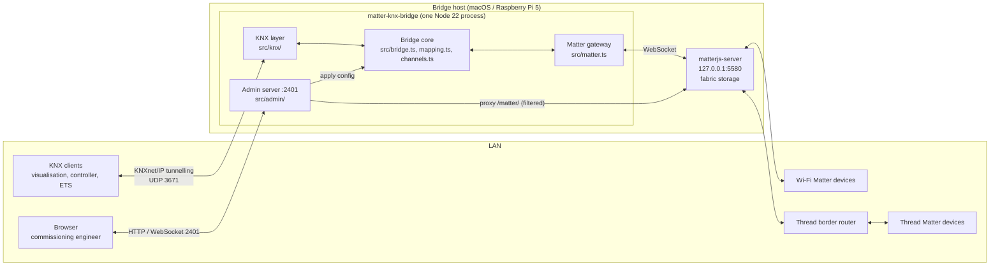

# Architecture

English | [Tiếng Việt](../vi/architecture.md)

## Overview

One Node.js process runs the bridge core, the KNX layer and the admin server. matterjs-server is a separate process on the same host, reachable only on `127.0.0.1`.

## Components

| Path | Role |
|---|---|
| `src/main.ts` | Entry point. Loads `config.json`, generates the admin password on first run, wires the parts together, handles SIGINT / SIGTERM |
| `src/config.ts` | Loads and validates the configuration, slot limits, unlock binding check |
| `src/channels.ts` | Channel model: names, types, cmd / fb, parsing and value coercion |
| `src/bridge.ts` | Core. Turns channel commands into Matter commands or attribute writes, tracks pending state and timeouts per device, blocks unlock unless enabled, publishes channel changes |
| `src/mapping.ts` | Matter clusters and attributes to channel values (pure functions) |
| `src/matter.ts` | WebSocket client to matterjs-server (`@matter-server/ws-client`), reconnects with backoff (1 s up to 30 s) |
| `src/knx/frames.ts` | KNXnet/IP packets, cEMI frames, DPT codecs |
| `src/knx/server.ts` | KNXnet/IP tunnelling server: search, description, connect, heartbeat, tunnelling, ACK and resend, forwarding between tunnels |
| `src/knx/gateway.ts` | Group address to channel bindings, transforms, config validation for `knx` |
| `src/admin/server.ts` | Admin HTTP server: auth, session cookie, JSON API, static UI, apply, export, locks |
| `src/admin/matter-proxy.ts` | HTTP and WebSocket proxy to the matterjs-server dashboard with DoorLock filtering |
| `src/admin/project.ts` | `project.json`: floors, rooms, assignments, snapshots, validation |
| `src/admin/plan.ts` | Project to group addresses (via the planner), manual overrides, reserved and duplicate checks, bridge slots and `knx.objects` |
| `src/admin/planner/` | Planner interface (`types.ts`), built-in scheme `builtin-v1` (`builtin.ts`), loading of `admin.planner_module` (`load.ts`) |
| `src/admin/ets.ts` | ETS GroupAddress-Export XML and CSV writers, reader for ETS exports (import of reserved addresses) |
| `src/admin/suggest.ts` | Circuit type suggestion from Matter clusters |
| `src/admin/unlock.ts` | Unlock PIN hashing (scrypt), wrong-attempt lockout, audit log |
| `admin-ui/` | React + Vite single page app, built to `admin-ui/dist/` and served on 2401 |
| `scripts/set-unlock-pin.ts` | Sets the unlock PIN hash in `config.json` |
| `test/` | Node test runner tests with a fake Matter port and a simulated KNX client |

## Data flow

**KNX command**: client sends `GroupValue_Write` on a tunnel. `KnxServer` acknowledges, confirms with `L_Data.con`, forwards the telegram to the other tunnels, and hands it to `KnxGateway`. The gateway decodes the value with the DPT and transform of each `cmd` binding on that group address and calls `Bridge.command(channel, value)`. The core validates the value, sets `pending`, and sends the Matter command or attribute write through matter-server.

**Device state**: matter-server reports attribute changes. The core recomputes the channels of every slot on that node (`mapping.ts`), publishes the ones that changed, clears `pending` when the state matches what the command expected, and the KNX layer sends `GroupValue_Write` on the bound feedback group addresses to all tunnels. If no matching state arrives within `pending_timeout_ms`, `pending` goes back to `false` and `error` is set.

**Read**: `GroupValue_Read` on a feedback group address is answered from the current channel value.

**Admin apply**: the admin builds a plan from `project.json`, validates the resulting config, writes `config.json` (with backup), and calls `Bridge.setConfig` and `KnxGateway.setObjects`. Tunnels stay connected; every feedback group address is sent once with its current value.

## Design choices

- **Feedback only from the device.** Channels never echo a command. A KNX client shows what the device really did.
- **Neutral channel model.** The core knows nothing about KNX. Another front end can be added on top of the same channels.
- **One interface, virtual line.** The bridge is a tunnelling server, not a router. This keeps it simple and lets standard clients connect without extra hardware, at the cost of not sharing group addresses with a TP bus.
- **Door lock safety in layers.** KNX unlock off by default per lock, trigger semantics (0 never unlocks), dashboard proxy filtering, separate PIN with lockout and audit for the admin.
- **No build step for the server.** Node 22 runs the TypeScript sources directly (type stripping), which is why only erasable TypeScript syntax is used.
- **Local only.** No cloud service. matter-server is bound to localhost; KNX and admin are meant for the LAN.

## Files written at runtime

| File | Written by | Content |
|---|---|---|
| `config.json` | first start (generated password), admin apply, PIN change, `set-unlock-pin` | Configuration and secrets |
| `config.json.bak` | admin apply, PIN change, `set-unlock-pin` (copy of the previous `config.json`) | Backup, same secrets |
| `project.json` | admin | Project, applied and exported snapshots |
| `unlock-audit.log` | admin | Unlock audit, JSON lines |
| matter-server storage | matterjs-server | Fabric credentials, node data |
