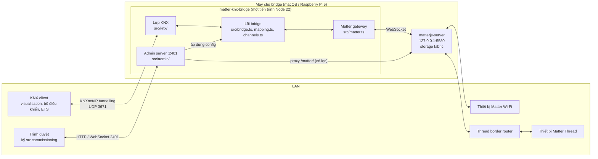

# Kiến trúc

[English](../en/architecture.md) | Tiếng Việt

## Tổng quan

Một tiến trình Node.js chạy lõi bridge, lớp KNX và admin server. matterjs-server là tiến trình riêng trên cùng máy, chỉ truy cập được qua `127.0.0.1`.

## Thành phần

| Đường dẫn | Vai trò |
|---|---|
| `src/main.ts` | Điểm vào. Nạp `config.json`, sinh mật khẩu admin ở lần chạy đầu, nối các phần với nhau, xử lý SIGINT / SIGTERM |
| `src/config.ts` | Nạp và kiểm tra cấu hình, giới hạn slot, kiểm tra gắn lệnh unlock |
| `src/channels.ts` | Mô hình channel: tên, kiểu, cmd / fb, phân tích tên và ép kiểu giá trị |
| `src/bridge.ts` | Lõi. Chuyển lệnh channel thành lệnh Matter hoặc ghi attribute, theo dõi trạng thái chờ và timeout cho từng thiết bị, chặn unlock khi chưa bật, phát thay đổi channel |
| `src/mapping.ts` | Quy đổi cluster và attribute Matter sang giá trị channel (hàm thuần) |
| `src/matter.ts` | WebSocket client tới matterjs-server (`@matter-server/ws-client`), tự kết nối lại với thời gian chờ tăng dần (1 s tới 30 s) |
| `src/knx/frames.ts` | Gói KNXnet/IP, frame cEMI, mã hoá DPT |
| `src/knx/server.ts` | KNXnet/IP tunnelling server: search, description, connect, heartbeat, tunnelling, ACK và gửi lại, chuyển telegram giữa các tunnel |
| `src/knx/gateway.ts` | Gắn group address với channel, transform, kiểm tra cấu hình `knx` |
| `src/admin/server.ts` | Admin HTTP server: xác thực, cookie phiên, JSON API, giao diện tĩnh, áp dụng, xuất, khoá cửa |
| `src/admin/matter-proxy.ts` | Proxy HTTP và WebSocket tới dashboard matterjs-server, có lọc DoorLock |
| `src/admin/project.ts` | `project.json`: tầng, phòng, gán thiết bị, bản chụp địa chỉ, kiểm tra hợp lệ |
| `src/admin/plan.ts` | Từ dự án ra group address (qua planner), địa chỉ tay, kiểm tra trùng và dành riêng, slot bridge và `knx.objects` |
| `src/admin/planner/` | Giao diện planner (`types.ts`), scheme tích hợp `builtin-v1` (`builtin.ts`), nạp `admin.planner_module` (`load.ts`) |
| `src/admin/ets.ts` | Ghi ETS GroupAddress-Export XML và CSV, đọc file xuất ETS (import địa chỉ dành riêng) |
| `src/admin/suggest.ts` | Gợi ý loại mạch từ cluster Matter |
| `src/admin/unlock.ts` | Hash PIN mở khoá (scrypt), khoá tạm khi sai nhiều lần, nhật ký |
| `admin-ui/` | Ứng dụng một trang React + Vite, build ra `admin-ui/dist/` và phục vụ ở 2401 |
| `scripts/set-unlock-pin.ts` | Ghi hash PIN mở khoá vào `config.json` |
| `test/` | Test chạy bằng Node test runner, dùng Matter port giả và KNX client mô phỏng |

## Luồng dữ liệu

**Lệnh KNX**: client gửi `GroupValue_Write` trên một tunnel. `KnxServer` gửi ACK, xác nhận bằng `L_Data.con`, chuyển telegram tới các tunnel khác và giao cho `KnxGateway`. Gateway giải mã giá trị theo DPT và transform của từng mục `cmd` gắn với group address đó, rồi gọi `Bridge.command(channel, value)`. Lõi kiểm tra giá trị, đặt `pending` và gửi lệnh Matter hoặc ghi attribute qua matter-server.

**Trạng thái thiết bị**: matter-server báo attribute thay đổi. Lõi tính lại channel của mọi slot trên node đó (`mapping.ts`), phát những channel đã đổi, xoá `pending` khi trạng thái khớp kết quả lệnh mong đợi, và lớp KNX gửi `GroupValue_Write` lên các group address phản hồi tới mọi tunnel. Nếu trong `pending_timeout_ms` không có trạng thái khớp, `pending` trở về `false` và `error` được đặt.

**Đọc**: `GroupValue_Read` trên group address phản hồi được trả lời từ giá trị hiện tại của channel.

**Áp dụng từ admin**: admin lập plan từ `project.json`, kiểm tra cấu hình kết quả, ghi `config.json` (có bản sao lưu), rồi gọi `Bridge.setConfig` và `KnxGateway.setObjects`. Tunnel vẫn giữ kết nối; mọi group address phản hồi được gửi một lần với giá trị hiện tại.

## Lựa chọn thiết kế

- **Phản hồi chỉ từ thiết bị.** Channel không bao giờ lặp lại lệnh. KNX client hiển thị đúng việc thiết bị đã làm.
- **Mô hình channel trung lập.** Lõi không biết gì về KNX. Có thể thêm front end khác dựa trên cùng bộ channel.
- **Một interface, line ảo.** Bridge là tunnelling server, không phải router. Cách này đơn giản và cho client chuẩn kết nối mà không cần thêm phần cứng, đổi lại không dùng chung group address với bus TP.
- **An toàn khoá cửa nhiều lớp.** Mở khoá qua KNX tắt mặc định cho từng khoá, lệnh kiểu kích hoạt (0 không bao giờ mở), proxy dashboard có lọc, PIN riêng có khoá tạm và nhật ký cho admin.
- **Server không có bước build.** Node 22 chạy thẳng mã TypeScript (type stripping), vì vậy chỉ dùng cú pháp TypeScript xoá được.
- **Chỉ chạy nội bộ.** Không dùng dịch vụ cloud. matter-server chỉ nghe localhost; KNX và admin dành cho LAN.

## File được ghi khi chạy

| File | Ghi bởi | Nội dung |
|---|---|---|
| `config.json` | lần chạy đầu (mật khẩu tự sinh), áp dụng từ admin, đổi PIN, `set-unlock-pin` | Cấu hình và bí mật |
| `config.json.bak` | áp dụng từ admin, đổi PIN, `set-unlock-pin` (bản sao `config.json` trước đó) | Bản sao lưu, chứa cùng bí mật |
| `project.json` | admin | Dự án, bản chụp đã áp dụng và đã xuất |
| `unlock-audit.log` | admin | Nhật ký mở khoá, JSON lines |
| Storage của matter-server | matterjs-server | Thông tin xác thực fabric, dữ liệu node |
